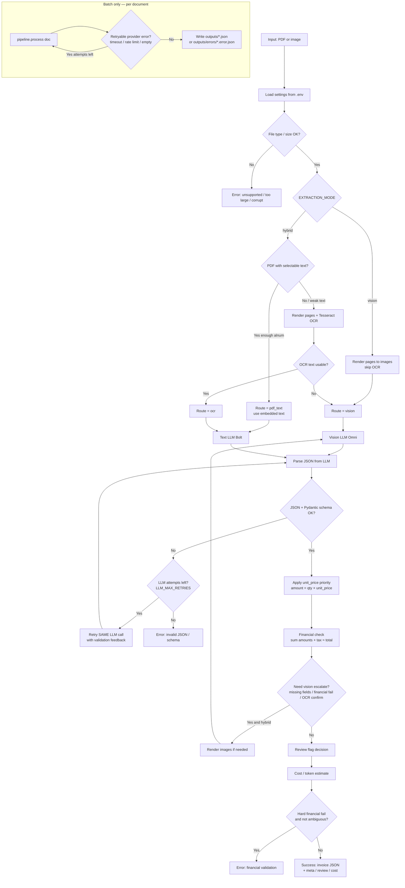

# Invoice Extraction Pipeline

Es Magico AI Internship Assignment — production-style invoice extraction with validation, evaluation, cost tracking, and bad-input handling.

## Problem

Finance teams receive mixed vendor documents (digital PDFs, scans, photos, and non-invoices). This pipeline:

1. Classifies whether a document is an invoice
2. Extracts structured fields into the assignment JSON schema
3. Validates schema + financial consistency
4. Evaluates against labelled ground truth
5. Reports API usage/cost honestly

---

## Current approach (default)

**OCR/text first → vision escalate** on NVIDIA Integrate free models:

| Role | Model | Why |
|---|---|---|
| Fast text first-pass | `nvidia/nemotron-3.5-bolt-e4b` | Low latency on clean digital text / OCR text |
| Vision repair | `nvidia/nemotron-3-nano-omni-30b-a3b-reasoning` | Accurate on scans/photos when OCR is wrong |

Default mode: `EXTRACTION_MODE=hybrid`

```text
Document
  ├─ Digital PDF with selectable text → Bolt (text LLM)
  └─ Scan / photo
        → Tesseract OCR → Bolt (text LLM)
        → if OCR route / missing fields / financial fail
              → Omni vision LLM (images)
  → Pydantic schema check → Decimal financial check → JSON + tokens/cost
```

Escalate to vision when:

- critical fields missing (`vendor`, `invoice_number`, `invoice_date`, `currency`, `tax_total`, `total`, `line_items`)
- financial check fails (`sum(line amounts) + tax ≈ total`)
- many OCR line-item quantities are null
- **or the route is `ocr`** (always confirm scans/photos with vision)

### Pipeline flow (every step)



### If a stage fails — restart from where?

| Failure | What happens | Resume point |
|---|---|---|
| **JSON / schema fail** inside one LLM pass | Retries the **same** text or vision call with feedback (`LLM_MAX_RETRIES`) | Continues from the **failed LLM parse** — does **not** re-route or re-OCR |
| **Escalate needed** after a valid first pass | Runs a **new** vision extraction on the already-routed doc | Continues from **vision LLM** — does **not** restart document load/OCR from scratch |
| **Batch retryable provider error** (timeout, rate limit, empty content) | Re-runs **full** `pipeline.process()` for that document only | Restarts that doc from the **beginning** (route → extract → validate again) |
| **Non-retryable / retries exhausted** | Document marked error; batch continues with others | **No** mid-pipeline checkpoint resume |

So: LLM parse failures resume at the LLM step; escalate continues into vision without redoing OCR; only batch-level provider retries restart the whole document from the start.

---

## Issues we faced, how we overcame them, and why

### 1) Dataset is mixed — one method is not enough

**Issue:** The pack mixes clean digital PDFs, scanned PDFs, photographed invoices, and non-invoices (e.g. purchase order L08).

**What we tried:** Assuming “PDF = readable text” or “one LLM call fits all”.

**How we overcame it:** Built a router:

- `pdf_text` for selectable text
- `ocr` for scans/photos via Tesseract
- `vision` when images must be trusted

**Why:** Digital text is cheap/fast; OCR/vision are only needed when embedded text is missing or unreliable.

---

### 2) Tesseract OCR alone was not accurate enough

**Issue:** On labelled hard docs, OCR + text LLM failed:

| Doc | Problem |
|---|---|
| L02.jpg (photo) | Quantities often null / wrong → `line_items` fail |
| L09.pdf (scan) | Digit noise → wrong amounts, tax, total, sometimes date/currency |
| L10.pdf (scan) | Quantities / money fields wrong |

First OCR-heavy eval: **overall ~70%**, with `line_items` at 70%.

**How we overcame it:** Stopped treating OCR text as final truth. Keep OCR as a **first pass**, then escalate hard cases to a **vision LLM** that reads the page image.

**Why:** OCR can produce “enough characters” to pass a length threshold while still corrupting digits and table columns. Vision recovers layout that Tesseract misses.

---

### 3) Vision-on-everything is accurate but slower/costlier

**Issue:** Vision-only A/B reached **100%** on labelled docs, but every clean digital PDF paid vision latency/tokens.

**How we overcame it:** Hybrid design:

- clean PDFs stay on fast Bolt text
- only OCR/scan/photo (or failed checks) call Omni vision

**Why:** Assignment cares about accuracy **and** cost/latency honesty. Hybrid keeps 100% labelled accuracy while keeping easy docs fast (~Bolt-only).

Measured comparison (10 labelled docs):

| Metric | OCR + Bolt only | Vision-only A/B | **Hybrid + escalate (current)** |
|---|---:|---:|---:|
| Overall accuracy | 70% | 100% | **100%** |
| `line_items` | 70% | 100% | **100%** |
| Avg latency | ~7.5 s | ~12.2 s | **~12.9 s** |
| Hard docs L02/L09/L10 | fail | pass | **pass via `ocr->vision`** |

---

### 4) Vision model was configured but never used (accuracy stayed at 70%)

**Issue:** `.env` had a vision model, but the pipeline never called it after a failed OCR/text pass. Failures still showed `route=ocr` and Bolt only.

**How we overcame it:** Implemented explicit escalate logic in `src/extraction/escalate.py` + `src/pipeline.py`:

1. first extract with text/OCR + Bolt  
2. validate schema + financials  
3. if escalate rules match and images exist → second call with Omni vision  
4. merge token usage from both passes for cost reporting  

**Why:** Configuration alone does not change behavior. Escalation had to be a first-class pipeline decision with logged reasons (`vision_escalate=...`).

---

### 5) “Missing fields” alone was not enough to trigger repair

**Issue:** On L02, Bolt sometimes returned **complete-looking JSON** (totals OK) but **wrong line items** (e.g. null quantities). Escalate-on-missing-fields did not fire.

**How we overcame it:** Added OCR-specific rules:

- escalate if many quantities are null on an OCR pass
- **always escalate `ocr` routes to vision** for confirmation

**Why:** OCR errors are often silent (wrong digits, not empty fields). For this dataset, confirming every OCR doc with vision recovered L02/L09/L10 without slowing digital PDFs.

---

### 6) Model selection on NVIDIA free catalog

**Issue:** We tried `z-ai/glm-5.3-flash` for text/vision. Exact text-only requests to NVIDIA Integrate **timed out** from this environment (no JSON response even after 60–180s).

**How we overcame it:** Probed available free models and picked:

- **Bolt E4B** — fast text first-pass (~0.8s smoke latency)
- **Nemotron Nano Omni** — reliable multimodal repair (worked on hard docs)

**Why:** Free catalog models differ in availability and latency. We chose models that were **reachable, fast enough, and accurate on our labelled failures**, not just the newest slug in a blog/snippet.

---

### 7) Non-invoice handling and schema strictness

**Issue:** For L08 (purchase order), the model sometimes returned `is_invoice: false` **but still filled vendor/amounts**. Pack schema requires all other fields null → validation error.

**How we overcame it:**

- Pydantic model enforces non-invoice nulls
- bounded retry with validation feedback
- prompt rules: PO / bank statement / cover letter ⇒ non-invoice null object

**Why:** Assignment requires schema-valid JSON and correct non-invoice behavior. Retry fixes transient schema mistakes without inventing invoice data.

---

### 8) Engineering / runtime issues

| Issue | Fix | Why |
|---|---|---|
| `pytest` could not import `src` | `pytest.ini` `pythonpath = .` + `tests/conftest.py` | Fresh clones must run tests without manual `PYTHONPATH` |
| `--meta` crashed on `Decimal` | JSON-safe conversion in pipeline | Financial results use Decimal; JSON needs floats |
| Disk full during `pip install` | Leaner pins (PyMuPDF 1.x), skip heavy optional UI until space frees | Reproducible local setup |
| Timeout too low (`LLM_TIMEOUT_SECONDS=10`) | Raise to 120 for hybrid | Vision repair needs headroom |

---

## Approach history (what we learned)

1. **OCR + text LLM** → fast, fails on scans/photos  
2. **Vision-only** → accurate, slower on clean PDFs  
3. **Hybrid + escalate (current)** → accurate like vision, fast on digital text, vision only when needed  

Detailed reports:

- `reports/ocr_baseline/` — OCR/text failures  
- `reports/vision_no_ocr/` — vision A/B + tokens/cost  
- `reports/hybrid_escalate/` — current 100% labelled run  
- `reports/mode_comparison.md` — side-by-side notes  
- `docs/ASSUMPTIONS.md` — documented decisions  
- `docs/DATASET_INVENTORY.md` — observed dataset facts  

---

## Architecture (short)

```text
Upload
  → File validation
  → Router (pdf_text | ocr | vision)
  → Extractor (Bolt text / Omni vision)
  → Optional vision escalate
  → Pydantic schema validation
  → Decimal financial validation
  → JSON output + token/cost metrics + review flags
```

See `docs/ARCHITECTURE.md` for the Mermaid diagram.

---

## Technology stack

| Component | Choice | Why |
|---|---|---|
| Language | Python 3.11+ | Document ecosystem, Pydantic, FastAPI |
| PDF/images | PyMuPDF + Pillow (+ OpenCV preprocess) | Text extract + page render for OCR/vision |
| OCR | Tesseract (`pytesseract`) | Local first pass for scans/photos |
| LLM provider | NVIDIA Integrate API | Free catalog; OpenAI-compatible client |
| Text model | `nvidia/nemotron-3.5-bolt-e4b` | Fast first-pass extraction |
| Vision model | `nvidia/nemotron-3-nano-omni-30b-a3b-reasoning` | Repair path for OCR/scans |
| Validation | Pydantic v2 | Exact pack schema |
| Money checks | `Decimal` | Avoid float drift |
| API | FastAPI | Optional upload endpoint |
| Eval | Field matching + normalization | Honest labelled metrics |

---

## Prerequisites

- Python 3.11+
- NVIDIA API key with Integrate access
- Tesseract OCR installed (default Windows path supported)

---

## Installation

```bash
git clone https://github.com/bhanreddy1973/Invoice-Extraction.git
cd Invoice-Extraction
python -m venv .venv
# Windows PowerShell:
.\.venv\Scripts\Activate.ps1
pip install -r requirements.txt
copy .env.example .env
```

Set `NVIDIA_API_KEY` in `.env`. Defaults:

```env
NVIDIA_TEXT_MODEL=nvidia/nemotron-3.5-bolt-e4b
NVIDIA_VISION_MODEL=nvidia/nemotron-3-nano-omni-30b-a3b-reasoning
EXTRACTION_MODE=hybrid
LLM_TIMEOUT_SECONDS=120
BATCH_WORKERS=10
BATCH_RETRIES=2
```

---

## Commands

Single document:

```bash
python extract.py data/raw/labelled/L01.pdf
python extract.py data/raw/labelled/L02.jpg --output outputs/labelled/L02.json --meta
```

Evaluate 10 labelled documents:

```bash
python evaluate.py --mode hybrid
# optional A/B:
python evaluate.py --mode vision
```

Batch all 20 documents (parallel + retries + live status):

```bash
# default workers from .env BATCH_WORKERS=10
python scripts/run_batch.py

# override if needed
python scripts/run_batch.py --workers 4 --retries 2
python scripts/run_batch.py --workers 1          # sequential
python scripts/generate_report.py
```

Status lines look like `[3/20] START ...`, `RETRY`, `OK`, `ERR`, plus rolling `Progress: ok/err`.
One document failing does **not** stop the batch; failed docs are written to `outputs/errors/`.

FastAPI:

```bash
uvicorn api.main:app --reload
# GET  /health
# POST /extract  (multipart file upload)
```

Streamlit UI (same pipeline as CLI/API):

```bash
streamlit run app_streamlit.py
```

Tests:

```bash
pytest -q
```

---

## Output schema

Extends the Es Magico pack schema (`data/schema.json`):

- line items: `description`, nullable `quantity`, nullable `unit_price`, `amount`
- when both `quantity` and `unit_price` are present, `amount` is set to `quantity × unit_price` (2 dp)
- non-invoice ⇒ all other fields `null`
- ISO dates `YYYY-MM-DD`
- ISO currency codes

---

## Validation logic

1. **Schema (Pydantic):** types, date/currency patterns, non-invoice null rules, no extra fields  
2. **Unit-price priority:** if qty and unit_price exist → overwrite amount = qty × unit_price  
3. **Financial:** `sum(line_item.amount) + tax_total ≈ total` with configurable Decimal tolerance  
4. **Escalate / review:** missing fields, financial mismatch, OCR confirmation → vision and/or `needs_review`

---

## Cost methodology

```text
cost_usd =
  (input_tokens  / 1_000_000) * input_price_per_million
+ (output_tokens / 1_000_000) * output_price_per_million
```

- Prices recorded in `src/monitoring/cost_tracker.py` (free-tier currently **$0 / 1M tokens**, with source + date)
- Token counts come from provider usage when returned
- Local Tesseract compute is excluded from API cost
- Escalated docs include **both** Bolt + Omni tokens in totals

Latest hybrid labelled usage (10 docs): ~20.3k input tokens, ~8.2k output tokens, **$0.00** API cost under free-tier table.

---

## Error-handling strategy

Typed errors (`UNSUPPORTED_FORMAT`, `UNREADABLE_DOCUMENT`, `INVALID_JSON`, `SCHEMA_VALIDATION_FAILED`, `FINANCIAL_VALIDATION_FAILED`, …).

- Non-invoice classification is a **valid result**, not an application error  
- Bounded LLM retries on invalid JSON/schema  
- Batch continues on per-document failure (parallel-safe)  
- Batch retries per document on `LLM_TIMEOUT` / `LLM_RATE_LIMIT` / `LLM_PROVIDER_ERROR`  
- Ambiguous financial mismatches are flagged for review rather than silently “fixed”

---

## Known limitations

- Free NVIDIA models may throttle, hang, or rotate catalog ids (we saw GLM Flash timeouts)
- Always-escalating OCR docs adds latency vs Bolt-only (trade accuracy for speed on hard docs)
- Line-item eval matching is order-sensitive after light normalization (no fuzzy awards)
- Tesseract remains a weak first pass; Omni vision is what recovers scan/photo accuracy

---

## Future improvements

1. Replace/augment Tesseract with NVIDIA `nemotron-ocr-v2` for better table OCR  
2. Smarter escalate (skip vision when OCR confidence + financial checks are strong)  
3. Calibrated review-flag precision/recall vs labelled errors  
4. Stronger fee/discount handling for residual mismatches (e.g. U04)

---

## Dataset

Sample pack under `data/raw/` and `data/ground_truth/`.  
Inventory: `docs/DATASET_INVENTORY.md`.
