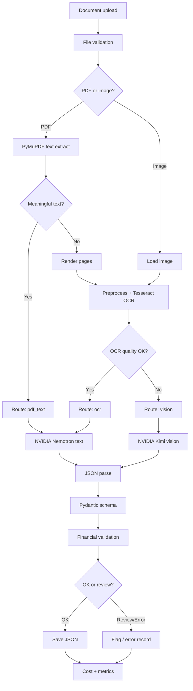

# Architecture

## Component responsibilities

| Module | Responsibility |
|---|---|
| `document_processing/` | Validate files, extract PDF text, preprocess images, OCR, choose route |
| `llm/` | NVIDIA provider, prompts, usage metadata |
| `extraction/` | Call LLM, parse JSON, retry on schema/JSON failures |
| `validation/` | Pydantic schema + Decimal financial checks |
| `evaluation/` | Normalize + score labelled predictions |
| `monitoring/` | Token/latency aggregation and cost estimates |
| `pipeline.py` | Orchestrate one document end-to-end |
| `api/main.py` | HTTP upload interface |
| `extract.py` / `evaluate.py` / `scripts/run_batch.py` | CLI entrypoints |

## Data flow

## Routing decisions

- `pdf_text`: embedded alphanumeric characters ≥ threshold (default 80)
- `ocr`: scans/photos with usable Tesseract output
- `vision`: OCR still weak; send page images to vision model
- Processing failures use typed error codes (`UNREADABLE_DOCUMENT`, `INVALID_JSON`, ...)

## Retry behavior

Bounded retries (`LLM_MAX_RETRIES`) on invalid JSON or schema failures, with validation feedback injected into the next prompt. Financial mismatches that look ambiguous are review-flagged; deterministic mismatches are not infinitely retried without new evidence.
